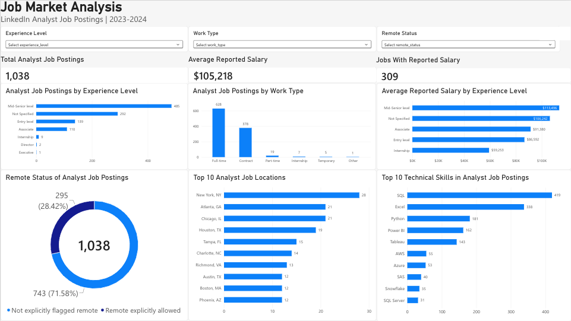
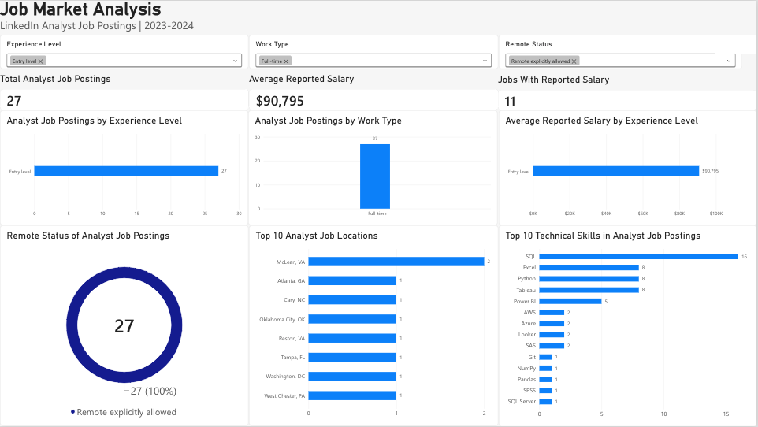

# Job Market Analysis

An end-to-end data analysis project exploring the analyst job market using LinkedIn job posting data from 2023–2024.

This project uses **Python and Pandas** for data cleaning and transformation, **PostgreSQL and SQL** for analysis and validation, and **Power BI** for interactive visualization.

## Dashboard



The Power BI dashboard provides an interactive view of the analyst job market and allows users to filter results by:

- Experience level
- Work type
- Remote status

The dashboard summarizes job volume, reported salaries, experience requirements, work arrangements, technical skill demand, and leading job locations.

## Interactive Filtering



The dashboard supports cross-filtering across all visuals.

For example, filtering for **Entry Level + Full-time + Remote Explicitly Allowed** reduces the dataset to 27 postings and dynamically updates salary, skill, location, and work-type insights.

## Key Findings

- **1,038 analyst job postings** matched the selected analyst-role criteria.
- **309 postings (29.8%)** contained usable salary information.
- Average reported salary was approximately **$105,218**.
- Median reported salary was approximately **$100,445**.
- **Mid-Senior Level** was the most common experience category with **485 postings**.
- **Entry Level** accounted for **139 postings**.
- **Full-time** was the most common work type with **628 postings**.
- **Contract** roles accounted for **378 postings**.
- **295 postings (28.4%)** were explicitly marked as allowing remote work.
- The most frequently mentioned technical skills were:
  - SQL — 419 postings
  - Excel — 338
  - Python — 181
  - Power BI — 162
  - Tableau — 143
- Among city-formatted locations, **New York, NY** had the highest posting count.

## Technical Skill Extraction

The original dataset included LinkedIn skill categories, but these were broad categories such as Information Technology, Analyst, and Research rather than specific technical tools.

To produce a more useful technical-skills analysis, I returned to the raw job descriptions and extracted technology mentions using Python and regular expressions.

Technologies tracked included:

`SQL`, `Excel`, `Python`, `Power BI`, `Tableau`, `AWS`, `Azure`, `SAS`, `Snowflake`, `SQL Server`, `DAX`, `Power Query`, `Git`, `PostgreSQL`, `MySQL`, `Databricks`, and others.

Each extracted record represents a unique relationship between a job posting and a technical skill.

## Data Model

The Power BI semantic model uses two primary tables.

### AnalystPostings

One row represents one analyst job posting.

Key fields include:

- Job ID
- Job title
- Company
- Experience level
- Work type
- Remote status
- Location
- Normalized salary
- Posting metadata

### AnalystTechnicalSkills

One job can appear multiple times because a posting may mention several technical skills.

Each row represents one unique:

`job_id + technical_skill`

relationship.

The two tables are connected through a **one-to-many relationship on `job_id`**, allowing filters from the posting-level table to propagate to the technical-skills analysis.

## Data Preparation

The original job-posting dataset contained **123,849 postings**.

The workflow included:

1. Cleaning and validating the original posting data
2. Standardizing missing experience and remote-status values
3. Filtering for core analyst roles
4. Validating job IDs and table relationships
5. Joining job postings with skill data
6. Extracting technical skills from job-description text
7. Loading analytical tables into PostgreSQL
8. Performing SQL-based analysis and validation
9. Preparing analytical data for Power BI
10. Building the semantic model and interactive dashboard

Core analyst roles included variations of:

- Data Analyst
- Business Analyst
- Business Intelligence / BI Analyst
- Reporting Analyst

## SQL Analysis

PostgreSQL was used to analyze and validate:

- Total analyst postings
- Experience-level distribution
- Remote-work distribution
- Work-type distribution
- Salary availability
- Average salary
- Median salary
- Salary by experience level
- Skill demand

SQL results were used as validation checkpoints while building the Power BI dashboard.

## Repository Structure

```text
job-market-analysis/
│
├── assets/
│   └── screenshots/
│       ├── job-market-dashboard-overview.png
│       └── job-market-dashboard-filtered.png
│
├── dashboard/
│
├── data/
│   ├── raw/
│   └── processed/
│
├── notebooks/
│
├── sql/
│   ├── 01_create_tables.sql
│   ├── 02_overview_analysis.sql
│   └── 03_skill_analysis.sql
│
├── src/
│   ├── clean_postings.py
│   ├── prepare_job_skills.py
│   ├── prepare_analyst_data.py
│   ├── extract_technical_skills.py
│   └── export_powerbi_workbook.py
│
├── .gitignore
├── README.md
└── requirements.txt
```

Raw and generated processed datasets are excluded from Git because of their size and because they can be recreated from the project scripts.

## Tools Used

- Python
- Pandas
- Regular Expressions
- PostgreSQL
- SQL
- Power BI / Microsoft Fabric
- Excel
- Git
- GitHub
- VS Code

## Dataset

**LinkedIn Job Postings (2023–2024)** by arshkon, available through Kaggle.

The dataset contains job-posting information along with related company, skill, salary, and mapping tables.

## Data Limitations

Salary analysis only includes postings with usable salary information.

Of the 1,038 analyst postings analyzed, **309 contained salary data**, so salary findings should not be interpreted as representative of every posting.

The original location field contains multiple levels of geographic detail. For the dashboard's **Top 10 Analyst Job Locations** visual, the analysis was restricted to locations formatted at the city/state level to provide a more consistent comparison.

Remote status should also be interpreted carefully. **“Not explicitly flagged remote” does not necessarily mean on-site.** It means the source data did not explicitly mark the posting as allowing remote work.

Technical-skill counts are based on mentions in job-description text and are not mutually exclusive. A single posting may mention several technologies.

## Skills Demonstrated

This project demonstrates:

- Data cleaning and transformation
- Exploratory data analysis
- Relational data modeling
- One-to-many joins
- SQL querying and validation
- Text-based feature extraction
- Regular-expression pattern matching
- KPI development
- Dashboard design
- Interactive filtering
- Data-quality investigation
- Communicating analytical limitations
- Git and GitHub project organization